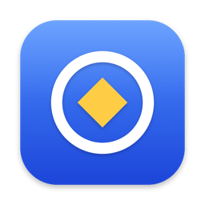
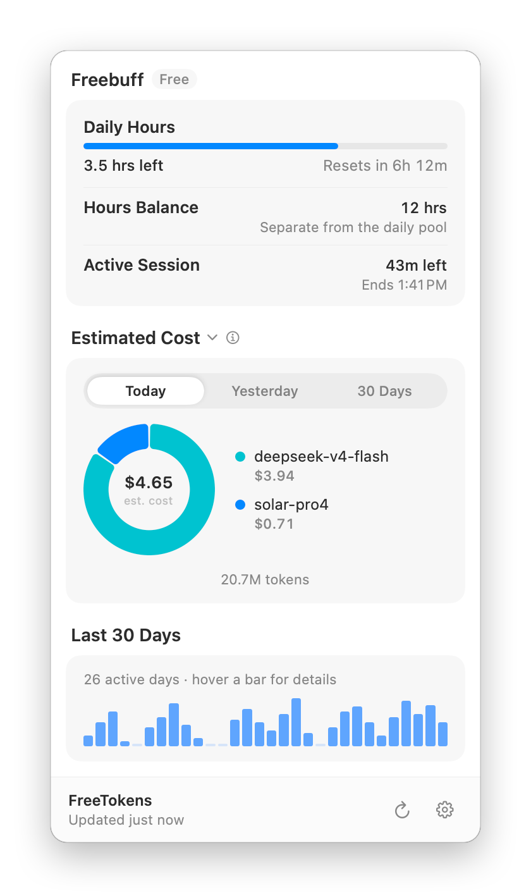
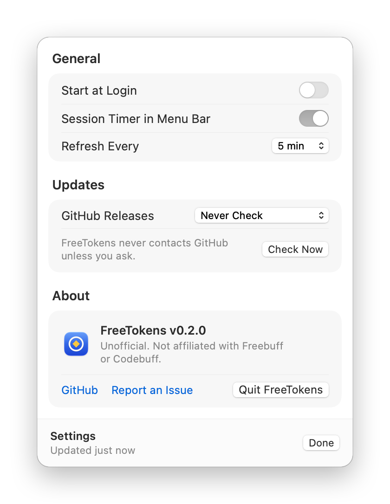

<p align="center">
  
</p>

<h1 align="center">FreeTokens</h1>

<p align="center">
  Your Freebuff hours, session timers and token usage in the menu bar, the system tray and the terminal.
</p>

<p align="center">
  <a href="https://github.com/tverma101/FreeTokens/releases/latest"></a>
  <a href="https://github.com/tverma101/FreeTokens/actions/workflows/ci.yml"></a>
  
  <a href="LICENSE"></a>
</p>

<p align="center">
  <picture>
    <source media="(prefers-color-scheme: dark)" srcset="docs/images/macos-panel-dark.png">
    
  </picture>
  
</p>

FreeTokens shows your Freebuff hours, session timers and measured token usage, with estimated
dollar costs at public API rates. On macOS it's a native menu bar app; on Windows it's a tray
popover; on Linux and the BSDs it's a system tray icon; everywhere it's also a command-line tool.
Token usage is measured from Freebuff and from the local history of the Antigravity app, Antigravity
IDE, the Agy CLI, Claude Code, Codex and OpenCode.

> **Unofficial.** FreeTokens is not affiliated with, endorsed by, or supported by Freebuff,
> Codebuff or CodebuffAI. It only reads your own usage with your existing Freebuff login.

## What it shows

| Row | Source |
| --- | --- |
| **Daily Hours** – hours left in today's free pool and when it resets | Freebuff session endpoint (read-only GET) |
| **Hours Balance** – your separate wallet, in whole hours (5 Freebucks = 1 hour) | same |
| **Monthly Spend** – when Freebuff reports USD | same |
| **Session timers** – time left on each active session, in the menu bar title on macOS and in the tooltip elsewhere | same |
| Legacy **Daily / Weekly / Monthly / 5-Day / Premium** session windows on older accounts | same |
| **Today / Yesterday / Week / Last 30 Days** tokens per model and by source, with estimated cost | Freebuff hosted run history, Freebuff Desktop's local history, and Antigravity app, IDE, Agy CLI, Claude, Codex and OpenCode local history |

The usage panel groups by **Tool** (the model row as measured, with the tool that ran it) or by
**Provider** (the company serving the model), and the donut, its legend and the breakdown all follow
that choice. Provider grouping keeps a Claude Code, Codex or OpenCode session running another
provider's model attributed to that provider. The per-source totals sit under the chart in both cases.

Token counts are measured receipts, never estimates. Dollar figures are **estimates at public API
prices** (the [OpenRouter](https://openrouter.ai/api/v1/models) model list and the OpenUsage
pricing supplement), not what Freebuff charges you. A total marked `≥` is a lower bound: some
tokens belong to a model with no public price, or some runs have no complete receipt yet.

## Install

Everything is on the [Releases](https://github.com/tverma101/FreeTokens/releases/latest) page.
Each release lists SHA-256 sums in `checksums.txt`.

### macOS (menu bar app)

1. Download `FreeTokens-<version>-macOS.zip` (one app for Apple silicon and Intel, macOS 13 or later).
2. Open the zip and drag **FreeTokens.app** into **Applications**.
3. Open FreeTokens. Releases aren't notarized yet, so the first launch is blocked. Go to
   **System Settings → Privacy & Security** and choose **Open Anyway**, or run this once:

   ```bash
   xattr -dr com.apple.quarantine /Applications/FreeTokens.app
   ```

4. Click the FreeTokens icon in the menu bar. Turn on **Settings → Start at Login** to keep it running.

If the menu bar is full, macOS may hide the icon; check **System Settings → Menu Bar**. Opening
FreeTokens again from Finder or Spotlight always shows the panel (at the top right of the screen
when the icon is hidden).
Right-click the icon for **Refresh Now**, **Settings** and **Quit**.

The app includes the command-line tool. To use it from a terminal:

```bash
sudo ln -s /Applications/FreeTokens.app/Contents/Helpers/freetokens /usr/local/bin/freetokens
```

### Windows

Download `FreeTokens-<version>-Setup-x64.exe` and run it: it installs per user (no admin
prompt) into `%LOCALAPPDATA%\Programs\FreeTokens`, adds Start Menu shortcuts, and offers
start-at-login and a desktop shortcut. The `freetokens_<version>_windows_amd64.zip` (or `arm64` /
`386`) is still there for a portable copy: extract it to a folder such as
`%LOCALAPPDATA%\Programs\FreeTokens`. Either way you get two copies of the same program:
`freetokens.exe` for the command line, and `freetokensw.exe`, which opens the popover without a
console window. Double-click `freetokensw.exe` (or run `freetokens.exe` with no arguments) and the
popover appears above the notification area; right-click the tray icon for **Refresh Now**,
**Settings** and **Exit**, and turn on **Settings → Start with Windows**. Windows may hide new tray icons under the **^** arrow; drag the icon onto the
taskbar to keep it visible. SmartScreen may warn on first launch because releases aren't
code-signed yet; choose **More info → Run anyway**.

### Linux and BSD

Download the archive for your platform, extract `freetokens` somewhere on your `PATH`, and run
`freetokens` from your desktop session to start the tray. The builds are pure Go with no system
libraries, so the CLI also works on servers. The tray needs a desktop with StatusNotifierItem
support: KDE, or GNOME with the AppIndicator extension, Xfce, Cinnamon, and others.

| OS | Architectures |
| --- | --- |
| macOS 13+ app | Universal (Apple silicon and Intel) |
| macOS 12+ CLI | `arm64`, `amd64` |
| Windows 10+ | `amd64`, `arm64`, `386` |
| Linux | `amd64`, `arm64`, `armv6`, `armv7`, `386`, `riscv64`, `ppc64le`, `s390x`, `loong64` |
| FreeBSD | `amd64`, `arm64` |
| OpenBSD | `amd64`, `arm64` |
| NetBSD | `amd64` |

The macOS CLI archives (`freetokens_<version>_darwin_<arch>.tar.gz`) are still published for
terminal-only use. After extracting one, clear the quarantine flag with
`xattr -d com.apple.quarantine ./freetokens`.

Windows archives include the popover UI. Linux and BSD archives keep the CGO-free classic tray, so
the same download also works on a server; see [Build from source](#build-from-source) for the
Linux popover.

The Windows popover is pure Go and uses the WebView2 runtime that ships with Windows 11 (Edge
installs it on Windows 10). The Linux popover is a cgo build against GTK 3 and WebKit2GTK; the
Linux/BSD CLI and classic tray stay pure Go. The tray needs a desktop with StatusNotifierItem
support: KDE, or GNOME with the AppIndicator extension, Xfce, Cinnamon, and others.

On Linux, `freetokens launcher install` adds a **FreeTokens** entry to your app menu
(`~/.local/share/applications`, or under `XDG_DATA_HOME`) with a generated icon, so it starts from
the menu instead of a terminal; `freetokens launcher remove` takes it out again. The BSDs have no
standard menu entry, so nothing is written there.

An AppImage is published for x86_64: download `FreeTokens-<version>-x86_64.AppImage`, run
`chmod +x` on it and start it. It carries the classic tray. **Start at Login** points the autostart
entry at the AppImage file rather than at the temporary mount it runs from, and the updater writes
the new image over that file (the running mount is never touched) and relaunches it.

### From source

With Go 1.26+:

```bash
go install github.com/tverma101/FreeTokens/cmd/freetokens@latest
```

`go install` builds without the popover and gives you the CLI plus the classic tray.

To build the macOS menu bar app (needs Xcode): `scripts/build-macos-app.sh` writes
`dist-app/FreeTokens.app`.

## Build from source

The popover frontend is embedded at compile time, so build it before the Go binary. Node 22+ is
required, plus GTK/WebKit headers on Linux. This builds the Windows and Linux popover; macOS
ships the SwiftUI app above, and the popover there is not part of a release.

```bash
npm --prefix cmd/freetokens/web ci
npm --prefix cmd/freetokens/web run build
go build -tags "gui production" ./cmd/freetokens
```

The `production` tag is required: without it Wails compiles a desktop stub that opens an error
dialog instead of the popover. On Linux the popover is a cgo build, so a plain `go install` or a
release archive gives you the CLI and the tray only. Install the headers first, then add the tag
that matches the installed WebKit: `webkit2_41` for 4.1 (Ubuntu 24.04+, Fedora 40+, Arch), nothing
for 4.0 (Debian 12, Ubuntu 22.04).

```bash
sudo apt install libgtk-3-dev libwebkit2gtk-4.1-dev # Debian/Ubuntu
npm --prefix cmd/freetokens/web ci
npm --prefix cmd/freetokens/web run build
go build -tags "gui production webkit2_41" ./cmd/freetokens
```

`freetokens diagnose` prints `"popover": true|false`, so you can confirm which front end a binary
was built with before hunting for a window.

The built popover links GTK 3 and WebKit2GTK 4.1, which the same distributions already install for
other applications (`libgtk-3-0` and `libwebkit2gtk-4.1-0` on Debian/Ubuntu, `gtk3` and
`webkit2gtk4.1` on Fedora). CI compiles this target on every change.

Without `-tags gui`, the same source builds the CGO-free CLI and classic tray. Releases are built
with GoReleaser, which runs the frontend build first.

## Publish a release

Tagged pushes run [.github/workflows/release.yml](.github/workflows/release.yml) on a macOS runner.
To cut a release from Windows without CI, `scripts/release/PublishReleaseGui.ps1` builds the same
downloads locally and uploads them with the GitHub API:

```powershell
powershell -ExecutionPolicy Bypass -File scripts\release\PublishReleaseGui.ps1
```

It produces the Windows zip and Inno Setup installer, the Linux and macOS CLI archives and, on a
Mac, `FreeTokens-<version>-macOS.zip`, plus `checksums.txt` and winget/Scoop/Homebrew manifests for
the files it built. The tag-triggered workflow publishes the same set and adds the Linux AppImage,
which needs a Linux host to build. See [scripts/release/README.md](scripts/release/README.md) for
prerequisites and options.

## Use

```bash
freetokens            # popover when a desktop session exists, otherwise a status report
freetokens tray       # classic tray / menu bar menu
freetokens status     # one-off report; --json for scripts
freetokens export --csv   # the retained daily rollups as CSV
freetokens autostart on   # on Windows this registers freetokensw.exe
freetokens launcher install   # Linux: add an app-menu entry
```

```text
$ freetokens status
Freebuff · free
  Daily Hours: 3.5 h left of 5 h · resets in 6h 12m
  Hours Balance: 12 h
  Session 1: 42m left

Tokens (estimated at public API rates)
  Today: 20.73M tokens · ~$4.65
    deepseek/deepseek-v4-flash: 18.42M · ~$3.94
    upstage/solar-pro4: 2.31M · ~$0.71
  Last 30 Days: 700.55M tokens · ~$155.31
```

The screenshots and sample above use demo data.

## What the panel shows

The panel leads with today's hours, then a period picker over the token mix: a ring of each model's
share, the period's total in the middle, and a legend beside it. Hovering a slice points the legend
at it, and **Copy** puts the mix on the clipboard. The menu beside the title switches between token
and cost values, groups rows by **Tool**, **Provider** or (opt-in) **Project**, and can split the
ring into **Token kinds** — cache reads, input, output and cache writes — with the cache-hit rate
under it. The breakdown below repeats the split per model when **Token kinds** is expanded there.

**Monthly budget.** Set a ceiling in **Settings** (`freetokens config set budget-usd 250`); the mix
shows the rolling 30-day estimate against it, e.g. `~$155 of $250 · 62%`, and the ring's hole
switches to what is left when clicked. Zero or an empty field turns the line off.

**Movers** need no switch: under the period tabs the mix names the models that changed most against
the previous window. **Usage history** (opt-in, off by default) is one switch for all three history
views — the **Last 30 Days** bar card and the previous-period comparison directly under the mix, and
the hour-of-week heatmap below the movers. Turn it off and the panel is back to the period mix alone.
Every heatmap cell names its weekday, hour and value on hover. Only readers that dated individual
turns contribute hours, so a store that records only daily totals leaves the heatmap short rather
than inventing a time.

**Settings → Usage Sources** shows the first reader with the inputs it found, when it last read it
and why a count is short (unreadable files, a failed read, no sign-in); **Show all** opens the rest.
That turns *totals may be incomplete* into something actionable. **Copy daily CSV** copies the same rows `freetokens export
--csv` prints: one row per local day with tokens, estimated cost and completeness flags.

You need to have signed in once with the Freebuff CLI (`freebuff login`). FreeTokens reads the
CLI's existing `default` profile and never signs in, starts a session, or changes your account. It
looks for the token in these places, in order:

1. `authToken` in `$XDG_CONFIG_HOME/manicode/credentials.json` (Linux and any system that sets
   `XDG_CONFIG_HOME`), else in `~/.config/manicode/credentials.json`, or in
   `$FREEBUFF_CONFIG_DIR/credentials.json`.
2. Current Freebuff CLIs store the token in the OS credential store under service `freebuff-cli`:
   the macOS Keychain, Windows Credential Manager, or the Secret Service on Linux.
3. `CODEBUFF_API_KEY`.

**Credential prompts.** Background refreshes never show a password or keychain prompt. If the OS
needs your approval, the tray shows a warning. Choose **Refresh Now** (on macOS, **Allow
Access…** in the panel), or run `freetokens status --prompt`, and allow access.

On macOS, choose **Always Allow**. The Keychain ties that approval to the binary's code signature,
and releases are not Developer ID-signed yet, so macOS asks once more after each update.

Freebuff's local history is read-only, and FreeTokens only reads its usage counters and model
fields, never conversation text. The app is an Electron build, so its directory is named after the
product and follows each platform's convention: `$XDG_CONFIG_HOME/Freebuff` on Linux (`~/.config/Freebuff`
when the variable is unset), `~/Library/Application Support/Freebuff` on macOS, and
`%APPDATA%\Freebuff` on Windows — plus the config directory the app and its CLI use on every
platform, where earlier builds wrote `freebuff-desktop`. FreeTokens searches each base directory for
anything named `freebuff…`, then a
few levels below it for SQLite files, and accepts only the ones whose schema has
the app's `messages` and `threads` tables, so Electron's caches and state files are never mistaken
for history. Every usable database under those directories is read; nothing is truncated at a
fixed count. `freetokens diagnose` lists the directories searched and how many databases were
found. Hosted history events other than metrics are skipped without being decoded.

Some Freebuff Desktop installs keep their history in the project instead of the app directory
(`<project>/.freebuff/desktop-v2.db`). FreeTokens doesn't guess where your projects are and never
walks your home directory, so those stores are opt-in: set `FREETOKENS_HISTORY_DIRS` to a
path-list of project roots (or `.freebuff` directories), separated by `:` on macOS and Linux and
`;` on Windows. Without it, only the app's own directories are searched, and the totals below say
nothing about the workspaces that weren't named.

Every local reader keeps only the last 31 days of individual turns, because the panel shows no
period older than 30 days; older turns are dropped as they age out rather than held in memory for
the life of the process.

Antigravity's local stores (`~/.gemini/antigravity*/conversations/*.db`) are also read-only. The
scanner decodes each generation record to keep its token counters, model identity and step
timestamp; prompts and tool payloads are discarded and never stored or sent. A generation is dated
by the step whose token counters match it exactly; when no step matches, the next step's time is
used without claiming that step, so a following generation that does match keeps its measured time.
That is an approximation, so it is labelled as one: when a refresh has to place any generation that
way, the panel says how many of the run's generations were dated at the nearest step and that
Antigravity's per-day split is therefore approximate. The CLI logs the same counts. Antigravity usage is
labeled by source (**Antigravity**, **Antigravity IDE**, or **Agy CLI**) in the model breakdown, and totalled
per source (**Freebuff**, **Antigravity app**, **Antigravity IDE**, **Agy CLI**) above it.

Claude Code's transcripts (`~/.claude/projects/**/*.jsonl`) are read-only too. Only assistant
responses carrying a usage receipt are counted, one turn per message id, so a response split across
content blocks is not counted twice. Input, output, cache-write and cache-read tokens are all
included; prompts, thinking blocks and tool payloads are never kept. Those sessions are labelled
**Claude** in the model breakdown and the per-source summary, because Claude Code can also be pointed
at non-Anthropic models. The Claude desktop app keeps no local token receipts, so only Claude Code
sessions are measured.

Codex's session rollouts (`~/.codex/sessions/**/*.jsonl`), written by both the Codex CLI and the
Codex app, are read-only as well. Each `token_usage_record` is one model response, counted once by
response id and labelled **Codex**; sessions from Codex versions that only report a running total
fall back to the per-turn deltas. Codex counts cached input inside its input total, so those are
split out for the cost estimate instead of being counted twice. The rollouts do not distinguish the
CLI from the app, so both are reported under the single **Codex** source.

OpenCode's session database (`~/.local/share/opencode/opencode.db`, or `$XDG_DATA_HOME/opencode`)
is read-only too. Only `assistant` messages carrying token counters are counted: input, output,
reasoning and cache read/write, where reasoning is reported beside output rather than inside it and
input excludes cache reads. Prompts, tool output and diffs are never kept. Messages are labelled
**OpenCode** in the model breakdown and the per-source summary. OpenCode records the provider of
every message, so that measured vendor is shown even when the model name would suggest another one;
when the recorded id is a gateway or a host rather than a vendor (`openrouter`, `groq`), the model
id decides as it does for Claude and Codex. OpenCode's own Zen models, which no public catalog
lists, are shown as **OpenCode Zen**.

## Updates (opt-in)

FreeTokens never contacts GitHub unless you ask it to. In the macOS app, use **Settings →
Updates**. The Windows popover's **Settings → Updates** checks for a newer release, links to it
without installing anything, sets the same policy as the tray menu, and can skip a version so it
isn't announced again. The classic tray keeps the automatic options under **Settings →
Updates from GitHub Releases**:

- **Never Check** (default)
- **Check Daily and Notify** shows an **Install** item when a release is available
- **Check Daily and Auto-Install** downloads, verifies and restarts automatically

Or from the CLI:

```bash
freetokens config set auto-update notify      # off | notify | auto
freetokens config set skipped-version 0.2.0   # empty clears the skip
freetokens update --check
freetokens update
```

Each update is checked against the release's `checksums.txt` (SHA-256) before anything is
replaced. The macOS app updates as a whole: the new FreeTokens.app must also pass a code signature
check before it replaces the old one, and then the app relaunches. A Linux AppImage is updated by
replacing the file named by `$APPIMAGE` and relaunching it, so a release that carries an AppImage
asset can update in place. If FreeTokens is installed somewhere you can't write, such as a system
directory, update it the way you installed it.

## Settings and files

| What | Where |
| --- | --- |
| Settings | the popover gear, the tray's **Settings**, or `freetokens config get`; `freetokens config path` names the file (in your OS config directory under `FreeTokens/`) |
| Caches, tray log | the OS cache directory under `FreeTokens/` (e.g. `~/Library/Caches/FreeTokens`) |
| Diagnostics | `freetokens diagnose` prints paths, auth state and numeric quota fields, never tokens |

The popover's **Settings** panel is a stack of cards: **General** (start at login, the session
timer in the menu bar, refresh interval), **Appearance**, the **Menu bar figure** (session
countdown, hours left, tokens today, cost today or nothing), the monthly budget, **Usage** history
and project grouping, **Sources**, **Updates** with **Check Now** and **Skip this version**,
**Report** with **Copy status** / **Copy daily CSV**, and **About**.

**Appearance** ships five themes: **Dark** (the default neutral graphite with a blue accent),
**Light**, **Sand** (the older warm sepia), **System** to follow the OS appearance, and **Custom**.
Custom builds the whole palette from four colours — accent, background, card and text — picked with
a colour well or typed as hex, and every colour in the panel is derived from them. A theme applies
to the panel only; the tray icon and menu bar title follow the system. The macOS app's **Settings**
offers the same five themes and the same four custom colours, drawn from the same keys. Themes also
work from the command line:

```bash
freetokens config set refresh-minutes 15
freetokens config set theme system        # dark | light | sand | system | custom
freetokens config set accent-color "#ff2d55"  # saves a colour and picks the custom theme
freetokens config set budget-usd 250          # 0 turns the budget line off
freetokens config set tray-title tokens       # session | hours | tokens | cost | none
freetokens config set show-history true       # the 30-day bars, the comparison and the by-hour grid
freetokens config set show-projects true      # the Project grouping in the mix
```
`freetokens config reset` puts every key back to its shipped default, which is the quick way out
of a stuck update skip or a hand-edited file, and `freetokens config path` prints the file to edit
by hand (with a note when it doesn't exist yet and the defaults are in effect).

## Privacy

FreeTokens sends requests only to:

- `www.codebuff.com`: your session, model catalog and run history, with your token
- `openrouter.ai` and `robinebers.github.io`: public price lists, without your token
- `api.github.com`: release checks, only when you enable updates

Redirects are refused, so your token can't be forwarded to another host. Caches hold no tokens.
The hosted-history cache is keyed by a SHA-256 of the token and is readable only by you.

## Differences from the QuotaBar tracker

The tracker is a port of the Freebuff provider from a QuotaBar fork, and the macOS panel follows
its design. FreeTokens is standalone and covers Freebuff only. Behavior matches the original
tracker, with two exceptions:

- Pricing uses only exact Freebuff routes (the supplement, then OpenRouter). The fuzzy LiteLLM and
  models.dev fallbacks are left out, so some unrecognized models show as unpriced instead of
  getting an approximate price.
- One supplement alias rule uses a regex lookahead that Go can't compile. It covers a Gemini
  model, not a Freebuff route, and is skipped.

## Credits

- The tracker logic and the macOS panel design are adapted from a fork of
  [OpenUsage](https://github.com/robinebers/openusage) (QuotaBar) by Robin Ebers (MIT). See [NOTICE](NOTICE).
- The popover is built with [Wails](https://wails.io), React, Vite and Tailwind CSS.
- [fyne.io/systray](https://github.com/fyne-io/systray),
  [go-selfupdate](https://github.com/creativeprojects/go-selfupdate),
  [modernc.org/sqlite](https://gitlab.com/cznic/sqlite),
  [go-keyring](https://github.com/zalando/go-keyring), [wincred](https://github.com/danieljoos/wincred),
  [go-timezone-local](https://github.com/thlib/go-timezone-local).

## License

[MIT](LICENSE)
